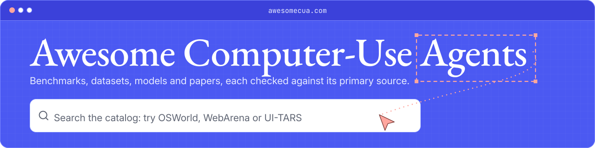

<h1 align="center"><a href="https://awesomecua.com/"><picture><source media="(prefers-color-scheme: dark)" srcset="assets/brand/readme-banner-dark.svg"></picture></a></h1>

A source-backed collection of papers, models, datasets, benchmarks and tools for agents that use computers.

**English** · [简体中文](README.zh-CN.md)

**[Search the website](https://awesomecua.com/)** · **[Papers](https://awesomecua.com/papers/)** · **[Topics](https://awesomecua.com/topics/)** · **[Data](https://awesomecua.com/data/)** · **[Agent guide](https://awesomecua.com/agents/)** · **[Contribute](CONTRIBUTING.md)**

If this collection is useful, a [star on GitHub](https://github.com/reacher-z/Awesome-CUA) helps others find it.

<!-- BADGES:START -->
[](docs/coverage.md) [](docs/papers.md) [](docs/maintenance.md) [](https://huggingface.co/datasets/TIGER-Lab/AwesomeCUA) [](LICENSE)
<!-- BADGES:END -->

Curated entries were reviewed against a first-party source snapshot; records awaiting review have their bibliographic identity checked; candidates are discovered identifiers awaiting resolution. [What “verified” means](#what-verified-means) · [Coverage ledger](docs/coverage.md)

## Featured benchmarks

| Website reconstruction                                                                                                                                                                                                                                                                                                                                                                                                                                                                                                                                                         | Browser agents                                                                                                                                                                                                                                                                                                                                                                                                                                                                                                                                                              |
| ------------------------------------------------------------------------------------------------------------------------------------------------------------------------------------------------------------------------------------------------------------------------------------------------------------------------------------------------------------------------------------------------------------------------------------------------------------------------------------------------------------------------------------------------------------------------------ | --------------------------------------------------------------------------------------------------------------------------------------------------------------------------------------------------------------------------------------------------------------------------------------------------------------------------------------------------------------------------------------------------------------------------------------------------------------------------------------------------------------------------------------------------------------------------- |
| <a href="https://github.com/TIGER-AI-Lab/WebsiteBench"><picture><source media="(prefers-color-scheme: dark)" srcset="https://raw.githubusercontent.com/TIGER-AI-Lab/WebsiteBench/78f5558e8197bb91b3bab63428c12b92060ddc6f/assets/wordmark-dark.svg"></picture></a><br>Can AI agents rebuild websites through browser exploration?<br>[★ Star on GitHub](https://github.com/TIGER-AI-Lab/WebsiteBench) | <a href="https://github.com/TIGER-AI-Lab/ClawBench"><picture><source media="(prefers-color-scheme: dark)" srcset="https://raw.githubusercontent.com/TIGER-AI-Lab/ClawBench/c8409629f4f2f9768731350d764aeb3035946c5d/assets/brand/wordmark-dark.svg"></picture></a><br>Open-source benchmark for browser AI agents on daily tasks.<br>[★ Star on GitHub](https://github.com/TIGER-AI-Lab/ClawBench) |

**Featured:** [Awesome Reverse Engineering Anything](https://github.com/reacher-z/Awesome-REA) — a collection of tools, case studies and research for reverse-engineering websites, games, apps, native binaries, firmware and protocols.

<!-- TASKS:START -->
## Find by task

| Your task           | Start here                                                                                                                                                     | What you can find                                                                                                                            |
| ------------------- | -------------------------------------------------------------------------------------------------------------------------------------------------------------- | -------------------------------------------------------------------------------------------------------------------------------------------- |
| Find papers         | [Research library](https://awesomecua.com/papers/) · [Topics](https://awesomecua.com/topics/) · [Paper–asset connections](https://awesomecua.com/connections/) | Reviewed papers by year and topic, with original sources and the code, datasets and models linked to them through reviewed primary evidence. |
| Choose a benchmark  | [Benchmark guide](https://awesomecua.com/guides/gui-agent-benchmarks/)                                                                                         | Platforms, tasks, evaluators, and versions to compare.                                                                                       |
| Find training data  | [Training-data guide](https://awesomecua.com/guides/gui-agent-training-data/)                                                                                  | Supervision, splits, count units, and data licenses.                                                                                         |
| Build an agent      | [Agents](https://awesomecua.com/categories/agent/) · [Frameworks](https://awesomecua.com/categories/framework/)                                                | Implementation entry points, supported platforms, and papers.                                                                                |
| Use RAG or an agent | [Agent guide](https://awesomecua.com/agents/) · [Data hub](https://awesomecua.com/data/)                                                                       | Complete records or retrieval documents with review states and sources.                                                                      |

<details>
<summary>Local examples (after cloning; Python 3.11+, no dependencies required)</summary>

```sh
cd Awesome-CUA
python3 scripts/catalog.py search "grounding" --kind paper --status curated --limit 0 --json
python3 scripts/catalog.py search --kind benchmark --environment web --status curated --limit 0 --json
python3 scripts/catalog.py search --kind dataset --environment android --status curated --limit 0 --json
python3 scripts/catalog.py search --kind framework --status curated --limit 0 --json
python3 scripts/export_rag.py --output dist/rag-documents.jsonl
python3 scripts/catalog.py get arxiv:2404.07972 --related --json
```

</details>

<!-- TASKS:END -->

<!-- STATS:START -->

**2,170 curated resources** · **1,673 reviewed papers and surveys** · **104 discovery documents**

Evidence through `2026-11-06T17:14:14Z`. **450 records awaiting review** have verified bibliographic metadata, and **2,062 discovered candidates** await resolution. 1,308 scope exclusions retain their original metadata in the archive.

<!-- STATS:END -->

## Explore

<!-- EXPLORE:START -->
| Browse                                           | What you find                                                 | Entries |
| ------------------------------------------------ | ------------------------------------------------------------- | ------: |
| [Research by topic](docs/topics.md)              | Reviewed papers grouped by topic                              |   1,645 |
| [Full bibliography](docs/papers.md)              | All paper and survey records, including those awaiting review |   2,123 |
| [Surveys](docs/surveys.md)                       | Surveys of computer-use agent research                        |      28 |
| [Learning resources](docs/learning.md)           | Courses and tutorials                                         |       2 |
| [Datasets](docs/datasets.md)                     | Training and evaluation data for GUI agents                   |      86 |
| [Benchmarks](docs/benchmarks.md)                 | Evaluation environments and task suites                       |      91 |
| [Models and checkpoint releases](docs/models.md) | Checkpoints and model families                                |      98 |
| [Agents](docs/agents.md)                         | Open implementations that act on a computer                   |      49 |
| [Frameworks](docs/frameworks.md)                 | Code for building and evaluating agents                       |      87 |
| [Infrastructure](docs/infrastructures.md)        | Sandboxes, VMs, device farms and environments                 |      16 |
| [Tools](docs/tools.md)                           | Evaluation harnesses, recorders and other utilities           |      32 |
| [Products](docs/products.md)                     | Computer-use products from vendors and projects               |      20 |
| [Publishers and brands](docs/companies.md)       | Publishers and brands connected to cataloged resources        |      16 |

**By platform:** [Web](docs/environments/web.md) **858** · [Desktop](docs/environments/desktop.md) **364** · [Windows](docs/environments/windows.md) **68** · [macOS](docs/environments/macos.md) **36** · [Linux](docs/environments/linux.md) **57** · [Android](docs/environments/android.md) **350** · [iOS](docs/environments/ios.md) **26** · [HarmonyOS](docs/environments/harmonyos.md) **4** · [Cross-platform](docs/environments/cross-platform.md) **206**
<!-- EXPLORE:END -->

Coverage spans web, desktop, Android, iOS, Windows, macOS, Linux, and cross-platform work. Topics include grounding, screen understanding, planning, memory, long-horizon workflows, reinforcement learning, data generation, safety, robustness, and evaluation.

## Use the data

Download the catalog, feeds and RAG documents; the data hub also lists sources, review states and schemas.

- [llms.txt](https://awesomecua.com/llms.txt) - Navigation file for language models.
- [llms-full.txt](https://awesomecua.com/llms-full.txt) - Curated annotations in Markdown.
- [Data hub](https://awesomecua.com/data/) - Catalog, RAG documents, citations, topics, comparisons, sources and schemas in six groups.
- [Catalog JSONL](https://awesomecua.com/downloads/catalog.jsonl) - Complete catalog with one resource per line.
- [Download manifest](https://awesomecua.com/downloads/manifest.json) - Export counts, byte sizes and SHA-256 checksums.
- [Atom feed](https://awesomecua.com/feed.xml) - Research updates as an Atom feed.
- [Hugging Face dataset](https://huggingface.co/datasets/TIGER-Lab/AwesomeCUA) - Read-only mirror; metadata_only and github_candidates are unreviewed.
- [Agent and RAG guide](https://awesomecua.com/agents/) - Guide for agents and RAG systems.

Clone the complete catalog:

```sh
git clone https://github.com/reacher-z/Awesome-CUA.git
```

[Agent instructions](AGENTS.md) · [Retrieval documents](https://awesomecua.com/downloads/rag-documents.jsonl)

Discovery is scheduled **every hour at minute 7 UTC**. [Actual scan results](https://awesomecua.com/updates/) · [Schedule and safeguards](docs/maintenance.md).

[Read the research survey](https://awesomecua.com/survey/) — Methods, evaluation, human agency, and reusable research assets. English working manuscript with a versioned bibliography and reading register.

## Highlights

The most-mentioned curated resources per category: the count is how many other cataloged resources mention each one in their reviewed first-party source (README, model or dataset card). It reflects connectedness inside this catalog. Every category page lists all reviewed entries. Surveys come first, newest first.

<details>
<summary>Show the highlights tables</summary>

<!-- HIGHLIGHTS:START -->
**Start with the newest surveys** · [all 28 →](docs/surveys.md)

| Date       | Survey                                                                                                                                  | Environments   |
| ---------- | --------------------------------------------------------------------------------------------------------------------------------------- | -------------- |
| 2026‑10‑21 | [Multimodal Embodied Agents: A Unified Capability-centric Perspective from Computer-Use to Robot-Use](https://arxiv.org/abs/2610.30108) | unspecified    |
| 2026‑10‑14 | [Seeing, Maintaining, and Learning: The Evolution of Multimodal Agent Memory](https://arxiv.org/abs/2610.19366)                         | unspecified    |
| 2026‑09‑02 | [Efficient GUI Agents: A Systems Survey of Observation, Memory, Action, and Runtime Optimization](https://arxiv.org/abs/2609.02309)     | cross-platform |
| 2026‑08‑30 | [A Systematic Survey of Agentic Skills: Architecture, Lifecycle, and Security](https://arxiv.org/abs/2608.29596)                        | cross-platform |
| 2026‑08‑10 | [Software Engineering for and with GUI Agent](https://arxiv.org/abs/2608.09278)                                                         | web            |

**Benchmarks** · [all 91 →](docs/benchmarks.md)

| Resource                                                                       | Mentions | Environments                   | Paper                                                 | License         | Description                                                                         |
| ------------------------------------------------------------------------------ | -------: | ------------------------------ | ----------------------------------------------------- | --------------- | ----------------------------------------------------------------------------------- |
| [OSWorld](https://github.com/xlang-ai/OSWorld)                                 |       22 | desktop, linux, windows, macos | [2404.07972](https://arxiv.org/abs/2404.07972) (2024) | code Apache-2.0 | Execution-based evaluation of agents performing tasks in real desktop environments. |
| [WebArena](https://github.com/web-arena-x/webarena)                            |       15 | web                            | [2307.13854](https://arxiv.org/abs/2307.13854) (2023) | code Apache-2.0 | Self-hosted web environments and tasks for evaluating autonomous web agents.        |
| [BrowserGym](https://github.com/ServiceNow/BrowserGym)                         |        9 | web                            | [2412.05467](https://arxiv.org/abs/2412.05467) (2024) | code Apache-2.0 | Unified interfaces for browser-agent tasks and benchmark environments.              |
| [ScreenSpot Pro](https://github.com/likaixin2000/ScreenSpot-Pro-GUI-Grounding) |        8 | desktop, windows, macos, linux | —                                                     | code MIT        | GUI grounding benchmark focused on professional high-resolution interfaces.         |
| [VisualWebArena](https://github.com/web-arena-x/visualwebarena)                |        7 | web                            | [2401.13649](https://arxiv.org/abs/2401.13649) (2024) | —               | Visually grounded web tasks extending the WebArena evaluation setting.              |
| [AndroidWorld](https://github.com/google-research/android_world)               |        6 | android                        | [2405.14573](https://arxiv.org/abs/2405.14573) (2024) | code Apache-2.0 | Android environment with programmatic task evaluation for mobile agents.            |

**Models** · [all 98 →](docs/models.md)

| Resource                                           | Mentions | Environments   | Paper                                                 | License         | Description                                                                                                                                                                                            |
| -------------------------------------------------- | -------: | -------------- | ----------------------------------------------------- | --------------- | ------------------------------------------------------------------------------------------------------------------------------------------------------------------------------------------------------ |
| [SeeClick](https://github.com/njucckevin/SeeClick) |        9 | cross-platform | [2401.10935](https://arxiv.org/abs/2401.10935) (2024) | code Apache-2.0 | GUI grounding model trained to locate visual interface elements.                                                                                                                                       |
| [Aguvis](https://github.com/xlang-ai/aguvis)       |        5 | cross-platform | [2412.04454](https://arxiv.org/abs/2412.04454) (2024) | —               | Vision-based GUI agent models with unified action representations.                                                                                                                                     |
| [UI-TARS](https://github.com/bytedance/UI-TARS)    |        5 | cross-platform | [2501.12326](https://arxiv.org/abs/2501.12326) (2025) | code Apache-2.0 | Native GUI agent models; UI-TARS-1.5 adds reinforcement-learned reasoning before acting and an open 7B checkpoint, and UI-TARS-2 extends to games, code and tool use.                                  |
| [OpenCUA](https://github.com/xlang-ai/OpenCUA)     |        3 | desktop        | [2508.09123](https://arxiv.org/abs/2508.09123) (2025) | code MIT        | Open computer-use research stack including models and training resources.                                                                                                                              |
| [OS-Atlas](https://github.com/OS-Copilot/OS-Atlas) |        3 | cross-platform | [2410.23218](https://arxiv.org/abs/2410.23218) (2024) | code Apache-2.0 | OS-Atlas GUI action models, including grounding bases fine-tuned from InternVL2-4B and Qwen2-VL-7B-Instruct that accept any image size and output 0-1000 relative coordinates.                         |
| [ShowUI](https://github.com/showlab/ShowUI)        |        3 | cross-platform | [2411.17465](https://arxiv.org/abs/2411.17465) (2024) | code Apache-2.0 | Lightweight GUI-agent vision-language-action model from Show Lab and Microsoft, released with UI-guided token selection, training code, the ShowUI-web and ShowUI-desktop datasets and vLLM inference. |

**Datasets** · [all 86 →](docs/datasets.md)

| Resource                                                                              | Mentions | Environments                   | Paper                                                 | License  | Description                                                                                                                                                           |
| ------------------------------------------------------------------------------------- | -------: | ------------------------------ | ----------------------------------------------------- | -------- | --------------------------------------------------------------------------------------------------------------------------------------------------------------------- |
| [ScreenSpot-Pro data](https://huggingface.co/datasets/likaixin/ScreenSpot-Pro)        |        4 | desktop, windows, macos, linux | [2504.07981](https://arxiv.org/abs/2504.07981) (2025) | data mit | High-resolution professional interface screenshots and target annotations for evaluating instruction-based GUI localization.                                          |
| [GUI-Odyssey](https://github.com/OpenGVLab/GUI-Odyssey)                               |        3 | android                        | [2406.08451](https://arxiv.org/abs/2406.08451) (2024) | —        | Human-demonstrated Android episodes for cross-app navigation, spanning six task types, 212 apps and about 1,400 app combinations, for training and evaluating agents. |
| [GUIAct](https://huggingface.co/datasets/yiye2023/GUIAct)                             |        3 | web, android                   | [2406.11317](https://arxiv.org/abs/2406.11317) (2024) | —        | Web and Android GUI action-instruction data, with single-step, multi-step and smartphone partitions.                                                                  |
| [GUIChat](https://huggingface.co/datasets/yiye2023/GUIChat)                           |        3 | unspecified                    | [2406.11317](https://arxiv.org/abs/2406.11317) (2024) | —        | Conversational GUI supervision with text-rich images and bounding boxes, organized as single-turn questions and multi-turn dialogues.                                 |
| [GUIEnv-local](https://huggingface.co/datasets/yiye2023/GUIEnv)                       |        3 | web                            | [2406.11317](https://arxiv.org/abs/2406.11317) (2024) | —        | The released local-supervision portion of GUIEnv, pairing webpage regions and text for OCR and GUI grounding.                                                         |
| [OpenMobile-Data-v2](https://huggingface.co/datasets/OpenMobile-2/OpenMobile-Data-v2) |        3 | android, web                   | [2610.14157](https://arxiv.org/abs/2610.14157) (2026) | —        | Mobile-agent supervision from emulator and simulator trajectories, plus executable tasks with starting states and success checks for reinforcement learning.          |

**Frameworks** · [all 87 →](docs/frameworks.md)

| Resource                                                             | Mentions | Environments   | Paper                                                 | License         | Description                                                                                                                                                                                     |
| -------------------------------------------------------------------- | -------: | -------------- | ----------------------------------------------------- | --------------- | ----------------------------------------------------------------------------------------------------------------------------------------------------------------------------------------------- |
| [Browser Use](https://github.com/browser-use/browser-use)            |       10 | web            | —                                                     | code MIT        | Open-source browser agent library that runs locally with any LLM against a local or cloud browser, and also serves as a CLI for coding agents and as a driver for Claude's browser toolset.     |
| [AgentLab](https://github.com/ServiceNow/AgentLab)                   |        5 | web            | [2412.05467](https://arxiv.org/abs/2412.05467) (2024) | code Apache-2.0 | Experiment framework for developing and evaluating browser agents.                                                                                                                              |
| [Seg2Click](https://github.com/jcwang0602/Seg2Click)                 |        5 | cross-platform | [2610.16234](https://arxiv.org/abs/2610.16234) (2026) | code MIT        | Training and inference implementation that predicts an executable-region mask and derives a GUI click from that mask.                                                                           |
| [OpenMobile-2 code](https://github.com/OpenMobile2/OpenMobile2-Code) |        3 | android, web   | [2610.14157](https://arxiv.org/abs/2610.14157) (2026) | code Apache-2.0 | Evaluation adapters and training guidance for OpenMobile-2 across Android emulators and browser-rendered mobile simulation.                                                                     |
| [UI-Genie](https://github.com/Euphoria16/UI-Genie)                   |        3 | android        | [2505.21496](https://arxiv.org/abs/2505.21496) (2025) | —               | Training and evaluation code for a mobile-agent framework that iteratively generates trajectories using agent and reward-model feedback.                                                        |
| [Computer Use OOTB](https://github.com/showlab/computer_use_ootb)    |        2 | desktop        | [2411.10323](https://arxiv.org/abs/2411.10323) (2024) | code Apache-2.0 | Gradio desktop GUI agent for Windows and macOS that needs no Docker, using Claude 3.5 Computer Use over the API or ShowUI and UI-TARS run locally, with multi-display and phone remote control. |

**Agents** · [all 49 →](docs/agents.md)

| Resource                                                 | Mentions | Environments            | Paper                                                                                                                                                                                                                      | License         | Description                                                                                                                                                                                             |
| -------------------------------------------------------- | -------: | ----------------------- | -------------------------------------------------------------------------------------------------------------------------------------------------------------------------------------------------------------------------- | --------------- | ------------------------------------------------------------------------------------------------------------------------------------------------------------------------------------------------------- |
| [Mobile-Agent](https://github.com/X-PLUG/MobileAgent)    |        9 | android, cross-platform | [2401.16158](https://arxiv.org/abs/2401.16158) (2024), [2406.01014](https://arxiv.org/abs/2406.01014) (2024), [2508.15144](https://arxiv.org/abs/2508.15144) (2025), [2602.16855](https://arxiv.org/abs/2602.16855) (2026) | code MIT        | Mobile device agent family using visual interface interaction.                                                                                                                                          |
| [Agent S](https://github.com/simular-ai/Agent-S)         |        2 | desktop                 | [2410.08164](https://arxiv.org/abs/2410.08164) (2024), [2504.00906](https://arxiv.org/abs/2504.00906) (2025)                                                                                                               | code Apache-2.0 | Simular's open-source framework for computer-use agents that click, type and scroll through desktop and web apps on macOS, Windows and Linux; its third generation, Agent S3, reports 72.6% on OSWorld. |
| [SeeAct](https://github.com/OSU-NLP-Group/SeeAct)        |        2 | web                     | [2401.01614](https://arxiv.org/abs/2401.01614) (2024)                                                                                                                                                                      | —               | Generalist web agent framework for large multimodal models such as GPT-4V, with a Playwright tool that runs agents on live websites, text-choice and set-of-mark grounding, and a crawler mode.         |
| [Agent E](https://github.com/EmergenceAI/Agent-E)        |        1 | web                     | [2407.13032](https://arxiv.org/abs/2407.13032) (2024)                                                                                                                                                                      | code MIT        | Browser automation agent on the AG2 framework that pairs a planner agent with a browser navigation agent to fill forms, search shops and work through sites, also callable over a local HTTP API.       |
| [AppAgent](https://github.com/TencentQQGYLab/AppAgent)   |        1 | android                 | [2312.13771](https://arxiv.org/abs/2312.13771) (2023)                                                                                                                                                                      | code MIT        | Multimodal agent that operates Android apps through taps and swipes without back-end access, building a reusable knowledge base from autonomous exploration or from watching human demonstrations.      |
| [Auto-GUI / Auto-UI](https://github.com/cooelf/Auto-GUI) |        1 | android                 | [2309.11436](https://arxiv.org/abs/2309.11436) (2023)                                                                                                                                                                      | code Apache-2.0 | Screenshot-based mobile agent implementation with training and inference code for chain-of-action prediction.                                                                                           |

<!-- HIGHLIGHTS:END -->

</details>

## Recently reviewed

Newest editorial approvals of models, datasets, benchmarks, systems, and tools (newest first). New papers appear by date in the [topic hubs](docs/topics.md).

<details>
<summary>Show the recently reviewed table</summary>

<!-- RECENT:START -->
| Reviewed   | Resource                                                                                         | Kind      | Environments                   | Description                                                                                                                                                             |
| ---------- | ------------------------------------------------------------------------------------------------ | --------- | ------------------------------ | ----------------------------------------------------------------------------------------------------------------------------------------------------------------------- |
| 2026‑11‑06 | [web-eval-agent](https://github.com/refreshdotdev/web-eval-agent)                                | tool      | web                            | MCP server that launches a browser-use agent to run a web app, capture screenshots, console and network logs, and return a UX report to the coding agent.               |
| 2026‑11‑06 | [TestZeus Hercules](https://github.com/test-zeus-ai/testzeus-hercules)                           | agent     | web                            | Open-source testing agent that takes Gherkin features and executes them end to end on web applications through Playwright.                                              |
| 2026‑11‑06 | [TestDriver SDK](https://github.com/testdriverai/testdriverai)                                   | framework | desktop, web                   | Vitest plugin that spawns ephemeral devices and uses vision-based LLMs to build end-to-end tests of web apps, desktop apps and browser extensions.                      |
| 2026‑11‑06 | [Tactile](https://github.com/yliust/Tactile)                                                     | tool      | desktop, macos                 | Skill, protocol and tool layer that has agents operate software through accessibility semantics first, reading roles, names and states before reaching for screenshots. |
| 2026‑11‑06 | [SeleniumBase](https://github.com/seleniumbase/SeleniumBase)                                     | framework | web                            | Python browser automation framework for web crawling, end-to-end testing and scraping, with a recorder that generates tests and stealth options.                        |
| 2026‑11‑06 | [Qwen Code](https://github.com/QwenLM/qwen-code)                                                 | agent     | desktop                        | Qwen Code is an open-source coding agent that supports desktop automation through computer-use tools alongside terminal, editor, web, and chat interfaces.              |
| 2026‑11‑06 | [puppeteer-extra](https://github.com/berstend/puppeteer-extra)                                   | framework | web                            | A modular plugin framework for Puppeteer, maintained in a monorepo with plugins and related packages.                                                                   |
| 2026‑11‑06 | [Playwright MCP Server (ExecuteAutomation)](https://github.com/executeautomation/mcp-playwright) | tool      | web                            | Community MCP server that gives LLMs Playwright browser automation for interacting with web pages, taking screenshots, generating test code and running JavaScript.     |
| 2026‑11‑06 | [pi-computer-use](https://github.com/injaneity/pi-computer-use)                                  | tool      | desktop, macos, windows, linux | Pi extension that gives agents tools to find app windows, observe and search visible controls, click, type, scroll and wait for UI changes in desktop software.         |
| 2026‑11‑06 | [PhantomJS](https://github.com/ariya/phantomjs)                                                  | tool      | web                            | PhantomJS is a scriptable headless WebKit tool for automating web pages, capturing page contents, testing, and monitoring network activity.                             |
| 2026‑11‑06 | [OpenManus](https://github.com/FoundationAgents/OpenManus)                                       | framework | web                            | OpenManus is an open-source agent framework that runs tasks from a terminal and integrates browser execution and screenshots through Browser Use.                       |
| 2026‑11‑06 | [mcp-server-browser-use](https://github.com/Saik0s/mcp-browser-use)                              | tool      | web                            | MCP server that wraps browser-use so that an MCP client can automate a real browser, with a CLI, a web dashboard and a deep research mode.                              |
<!-- RECENT:END -->

</details>

## Data files and local queries

Browse the [interactive website](https://awesomecua.com/) to search and filter all resources, inspect source evidence, switch between English and Chinese, or download the complete catalog. [Website development and publishing](docs/website.md).

The [English data hub](https://awesomecua.com/data/) and [中文数据中心](https://awesomecua.com/zh/data/) organize public downloads into six groups: complete catalog, RAG documents, citations, topics and comparisons, sources and review status, and schemas. Cloning still gives you the complete source catalog; the hub provides exports from its published snapshot.

The [download manifest](https://awesomecua.com/downloads/manifest.json) records each listed export's actual count and unit, scope, byte size, and SHA-256 fingerprint. Compare `catalog_sha256` across manifests before combining files from different downloads.

[Reviewed research](https://awesomecua.com/papers/) · [Computer-use agent guides](https://awesomecua.com/guides/) · [Static resource directory](https://awesomecua.com/catalog/) · [Search and AI discovery](docs/search-discovery.md)

- **[Catalog JSONL](https://github.com/reacher-z/Awesome-CUA/blob/main/data/catalog.jsonl):** one resource per line, with stable IDs, typed fields, provenance, scoped licenses, and review status.
- **[Reference graph](https://github.com/reacher-z/Awesome-CUA/blob/main/data/references.jsonl):** outbound references from primary sources.
- **[Discovery registry](https://github.com/reacher-z/Awesome-CUA/blob/main/data/sources.json)** and **[candidates](data/candidates.jsonl):** source snapshots and where each identifier was found.
- **[Review queue](https://github.com/reacher-z/Awesome-CUA/blob/main/data/review-queue.jsonl):** unresolved evidence, unindexed discoveries, and proposals requiring editorial work. Discovered links reviewed as non-resources or as other addresses of indexed resources stay listed with a `resolution` and their reason.
- **[JSON Schema](https://github.com/reacher-z/Awesome-CUA/blob/main/schemas/resource.schema.json)** and **[coverage JSON](data/coverage.json):** machine-checkable contracts and coverage accounting.
- **[BibTeX](https://awesomecua.com/downloads/citations.bib)** and **[CSL JSON](https://awesomecua.com/downloads/citations.csl.json):** reviewed-paper citations with recorded authors, dates, and versions. Each resource page also provides its own `record.json`.

```bash
# Python 3.11+. Search and export require only the standard library.
cd Awesome-CUA
python3 scripts/catalog.py search "grounding" --kind model
python3 scripts/catalog.py search --kind dataset --environment android
python3 scripts/catalog.py search --kind product --status curated --json
python3 scripts/catalog.py get arxiv:2404.07972 --related --json
python3 scripts/catalog.py build
# Creates dist/catalog.sqlite and dist/catalog.json, with no network calls.
python3 scripts/export_rag.py --output dist/rag-documents.jsonl
python3 scripts/export_citations.py --format bibtex --output dist/citations.bib
# Add --include-metadata to include every active record, with its review state intact.
```

Use SQLite to join resources, environment/topic facets, and reviewed relations. See [query examples](docs/query-guide.md). `data/catalog.jsonl` is committed; SQLite and JSON array exports are reproducible local build products.

## What “verified” means

| State               | What has been checked                                                                                            |
| ------------------- | ---------------------------------------------------------------------------------------------------------------- |
| `curated`           | AI-assisted editorial review against a first-party source snapshot, with name, scope, summary, and taxonomy      |
| `metadata_verified` | Bibliographic identity, title, authors, and recorded dates checked against retained arXiv or publication sources |
| `candidate`         | A normalized URL or identifier was discovered                                                                    |

A paper, repository, dataset release, model checkpoint, product, and publisher can be separate related resources. Model families and individual checkpoints are explicitly linked where reviewed.

Code, data, weights, and document licenses are separate. Missing values are `null`.

## Maintain and verify

```bash
python3 -m venv .venv
.venv/bin/python -m pip install --require-hashes -r requirements-dev.txt
.venv/bin/python scripts/catalog.py validate
.venv/bin/python scripts/catalog.py build --check
.venv/bin/python -m unittest discover -s tests -v
.venv/bin/python scripts/catalog.py build
node --test tests/web.test.mjs
.venv/bin/python scripts/build_site.py
```

These commands match the checks that [Catalog quality](.github/workflows/catalog.yml) runs on every push and pull request, in the same order. They need Python 3.11+ and Node.js 24+, the `engines` version in `package.json` (CI uses Python 3.12 and Node.js 24). The web tests use only the built-in Node.js test runner, so nothing needs to be installed with npm. `npm run test:web` and `npm run build:web` are shortcuts for the last two commands.

Network discovery and verification are explicit commands; ordinary builds are offline. Changed primary snapshots require another editorial review before publication. [Maintenance guide](docs/maintenance.md) · [Methodology](docs/methodology.md) · [Data dictionary](docs/data-dictionary.md)

## Acknowledgments and reuse

The [source registry](data/sources.json) credits the community collections and surveys used for discovery. Bibliographic records use retained arXiv, publisher, and author sources; publication observations preserve edition-specific titles, authors, and date precision. Selected assets are checked against publisher repositories, documentation, and model/dataset cards. Upstream READMEs, papers, model weights, and datasets are not redistributed here.

Original repository code and annotations use the [MIT license](LICENSE). Linked resources retain their own terms.

To cite the catalog, use [CITATION.cff](CITATION.cff) or GitHub's "Cite this repository" button. The data changes with every scan, so pin the exact version you used. Each `v*` tag has a [data release](https://github.com/reacher-z/Awesome-CUA/releases) with versioned downloads built from the tagged commit: the catalog as JSONL, JSON and SQLite, the coverage ledger, topic and profile exports, and their `SHA256SUMS`. Cite the release tag, or record the commit from `git rev-parse HEAD` in your clone, or link files at that commit, such as `https://github.com/reacher-z/Awesome-CUA/blob/<commit>/data/catalog.jsonl`. [Cutting a release](docs/maintenance.md#versioned-data-releases).
